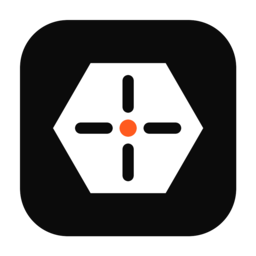

<p align="center"></p>

<h1 align="center">OpenLaser</h1>

<p align="center">Laser design and control software in Rust: galvo fiber lasers first (JCZ/BJJCZ LMC boards), GRBL gantry machines next.</p>

## Status

Work in progress. The first bench session on a JPT M7 MOPA (LMC board, USB `9588:9899`) ran on 2026-10-30:
see the log in [HARDWARE.md](HARDWARE.md). The software is **not** a safety system: the E-stop and key switch are.

## What it does

- Design: shapes, text, layers with per-layer cut settings, SVG/DXF/image import, LightBurn `.lbrn2` import.
- Image engraving (dithering) and a material test generator.
- Galvo output over USB with red-light framing, STOP from the window, and a first-emission power cap per bench session.
- Rotary (extended axis) strip marking, unverified on hardware (D12).

## Download

macOS (Apple Silicon and Intel) and Windows builds are on the [Releases](https://github.com/luizbueno3d/openlaser-rs/releases)
page. `README.txt` inside each download covers the first open (the apps are not signed yet) and the one-time WinUSB
driver on Windows. Start **OpenLaser** to design and simulate; start **Start OpenLaser with laser** to use the real
machine.

## Build

```sh
cargo run -p openlaser                          # simulator only
cargo build -p openlaser -p openlaser-hw --features hw   # real USB board (see HARDWARE.md first)
```

macOS needs no driver. On Windows the board needs the WinUSB driver (Zadig), which replaces EZCAD's.

## Docs

- [HARDWARE.md](HARDWARE.md): bring-up checklist, stop conditions, remaining risks, session log.
- [docs/DIVERGENCES.md](docs/DIVERGENCES.md): protocol changes against the reference implementation and their sign-off.
- [docs/LBRN2.md](docs/LBRN2.md), [docs/MATERIAL-TEST.md](docs/MATERIAL-TEST.md).

## License

MIT or Apache-2.0, at your option ([LICENSE-MIT](LICENSE-MIT), [LICENSE-APACHE](LICENSE-APACHE)).
